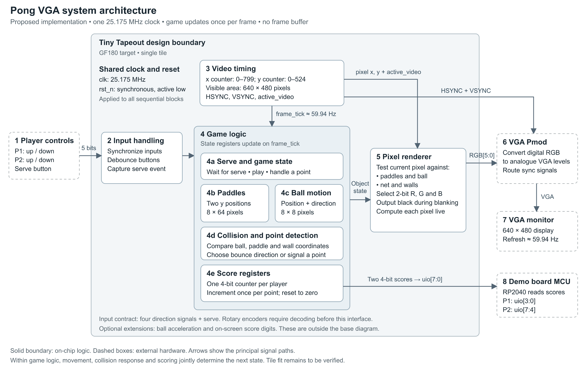
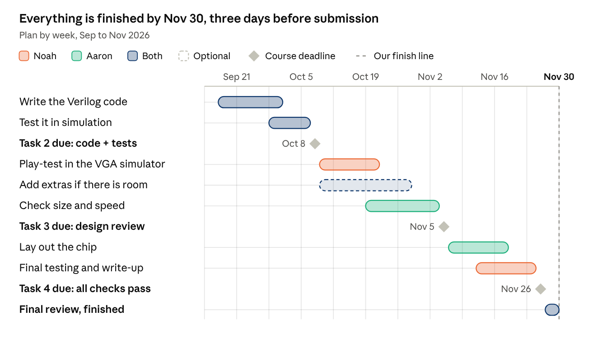

# Pong VGA (Tiny Tapeout GF180 1x1)

Two-player Pong with 640 x 480 VGA at **59.940476 Hz** with a 25.175 MHz clock. Hardware fit is determined by the **GDS build, Tiny Tapeout precheck, and gate-level tests** for the unchanged `1x1` GF180 tile. There is no 4,000-transistor limit; the transistor workflow is informational.

## Smooth motion and 10-45 degree angles

- Ball positions have **1/16-pixel fractional precision**, and the renderer uses **one-pixel resolution**. Fractional travel is retained between frames, avoiding the old 4-pixel jumps. Frames are updated atomically in vertical blanking.
- Paddle contact selects **10, 15, 20, 25, 30, 35, 40, or 45 degrees** from horizontal. Ball-center offset from paddle-center sets direction and angle; contact nearer the edges produces the steeper angles. Upper half aims up, lower half down. Four-pixel offset bands select the eight angles, with edge grazes clamped to 45 degrees.
- Ball speed increases **4 -> 6 -> 8 -> 10 pixels/frame**, every three paddle hits, capped after hit 9 and reset after scoring. These are now **normalized vector speeds**, not just the X or dominant-axis rate. A small constant lookup approximates `vx = speed*cos(angle)` and `vy = speed*sin(angle)` in Q4, with magnitude error below 0.05 px/frame. Both components therefore scale together and angle changes do not cause large speed changes.
- Paddles move **exactly 12 pixels/frame**, three times the original speed, and clamp to the walls. Opposing buttons cancel. Paddles still move while waiting to serve.
- Swept horizontal crossing tests prevent fast shots skipping over a paddle. Wall reflection preserves overshoot. Paddle overlap uses the wall-reflected destination Y and the updated paddle position; this is a frame-discrete collision model, not a continuous-time rigid-body solver.
- The 8x8 ball, 8x64 paddles, scores, controls, and wall positions remain. The center line stays removed.

## VGA Playground FPS versus hardware timing

The circuit emits a complete frame every 800 x 525 pixel clocks: `25,175,000 / 420,000 = 59.940476 Hz`. It needs that physical input clock to run at the stated rate.

VGA Playground's displayed FPS measures browser `requestAnimationFrame` timestamps. Its animation callback simulates and draws a frame. Thus 30-40 displayed FPS can reflect browser/CPU workload, display refresh, or scheduling; it is not evidence that the RTL generates 30-40 Hz VGA. See the [Playground animation loop](https://github.com/TinyTapeout/vga-playground/blob/main/src/index.ts) and [FPS counter](https://github.com/TinyTapeout/vga-playground/blob/main/src/FPSCounter.ts).

Keep the Playground foreground and close other costly tabs/processes when comparing performance. A 60 Hz or faster display and a browser that can finish each simulation frame in time are needed for 60 FPS presentation. More silicon does not guarantee faster browser simulation. On the physical chip, timing is controlled by the input clock and counters, subject to passing implementation timing checks. Slower browser presentation can still look less smooth even with the finer motion.

For Playground, paste `src/project.v` followed by `src/pong_vga_sync.v` into `project.v`. Keys 0-4 toggle the inputs; 4 serves and R resets. Holding serve auto-serves after a point. A one-frame MCU/encoder button pulse now moves a paddle exactly 12 pixels.

## Verification

- `cd test && make`: five cocotb VGA timing tests.
- `iverilog -g2012 -s tb_features -o /tmp/pong-features src/project.v sim/tb_features.v && vvp /tmp/pong-features`: all 128 speed/angle/direction combinations, subpixel pixel progression, both paddles across 142 contact offsets, hit thresholds, fixed paddle rate and clamping, swept collisions, reflected wall overshoot, score/reset/serve.
- `sh sim/run.sh 1600 rally`, `sh sim/run.sh 1600 ailate`, `sh sim/run.sh 1600 ai`, `sh sim/run.sh 1600 random 42`: full pin/pixel/reference, sync, and score comparisons. The independent C++ model calculates velocities with sine/cosine instead of copying the RTL table.
- `python3 synth/build_gf180_lib.py`, then `python3 synth/count_transistors.py --hier src/project.v src/pong_vga_sync.v`: diagnostic synthesis count/area, without an artificial transistor limit.
- GitHub `gds`: runs the original `ttgf26a` GF180 hardening action, precheck, and gate-level tests. Passing local RTL tests or the area estimate alone does not establish fit. Check the Actions result for the exact revision being submitted.

Local preliminary synthesis: **8,680 transistors, 85 flip-flops, 24,163 square micrometers** of cell area, 44.4% of nominal tile area. The tile size and placement-density settings are unchanged. The physical clock constraint is 39.7 ns, slightly stricter than the 39.7219 ns pixel clock period. Physics is evaluated only at the frame update in behavioral simulation.

## System Architecture

The proposed architecture uses a single 25.175 MHz clock, updates the game once per frame, and renders pixels without a frame buffer.

## I/O Pin Assignments

| Pin | Direction | Signal |
| --- | --- | --- |
| `ui_in[0]` / `ui_in[1]` | Input | Player 1 up / down button |
| `ui_in[2]` / `ui_in[3]` | Input | Player 2 up / down button |
| `ui_in[4]` | Input | Serve button |
| `ui_in[7:5]` | Input | Unused |
| `uo_out[0]` / `uo_out[4]` | Output | Red, MSB / LSB (`R1` / `R0`) |
| `uo_out[1]` / `uo_out[5]` | Output | Green, MSB / LSB (`G1` / `G0`) |
| `uo_out[2]` / `uo_out[6]` | Output | Blue, MSB / LSB (`B1` / `B0`) |
| `uo_out[3]` | Output | VSYNC, active low |
| `uo_out[7]` | Output | HSYNC, active low |
| `uio[3:0]` | Output | Player 1 score, 0-15, wrapping |
| `uio[7:4]` | Output | Player 2 score, 0-15, wrapping |
| `clk` | Input | 25.175 MHz pixel clock |
| `rst_n` | Input | Reset, active low |
| `ena` | Input | Unused; high while this design is selected |

Rotary encoders require decoding into the up/down control signals shown above.

## Proposed Specifications

| Parameter | Specification |
| --- | --- |
| Clock | 25.175 MHz VGA pixel clock |
| Video | VGA, 640 × 480 at approximately 60 Hz |
| Total video timing | 800 × 525 pixels, including blanking intervals |
| Colours | 64 colours, with 2 bits per RGB channel |
| Players | 2 |
| Paddle size | 8 × 64 pixels |
| Ball size | 8 × 8 pixels |
| Collision behaviour | Wall and paddle bounces; contact position selects one of eight mirrored angles from 10 to 45 degrees |
| Serve | Serve button starts play |
| Scoring | Four-bit scores from 0 to 15, wrapping, for each player |
| Pixel period | Approximately 40 ns |
| Line period | Approximately 32 µs |
| Frame period | Approximately 16.68 ms |
| Frame rate | Approximately 60 frames per second |
| Reset | Synchronous, active-low `rst_n`; clears scores to 0, centres paddles, and parks the ball until serve |
| External hardware | VGA monitor, rotary encoders, and a small MCU, with supporting hardware on a separate PCB |

## Project Timeline

The proposed schedule runs from September to November 2026, with all work planned to finish by **November 30**, three days before submission.

| Milestone | Planned Date |
| --- | --- |
| Task 2: Code and tests | October 8, 2026 |
| Task 3: Design review | November 5, 2026 |
| Task 4: All checks pass | November 26, 2026 |
| Final review and completion | November 30, 2026 |

## Team Responsibilities

| Area | Noah | Aaron |
| --- | --- | --- |
| Design (RTL) | Sync generator and pixel renderer | Game logic |
| Simulation | cocotb tests for sync timing and the renderer | cocotb tests for game logic; gate-level simulation |
| Design checking | Review game-logic RTL and tests | Review sync and renderer RTL and tests |
| Calculations | VGA timing and I/O rates | Transistor budget and timing slack at 25.175 MHz |
| Layout (GDS) | Documentation, precheck, and final CI run | Hardening runs, DRC/LVS, and extraction |
| Presentation and report | Shared | Shared |
