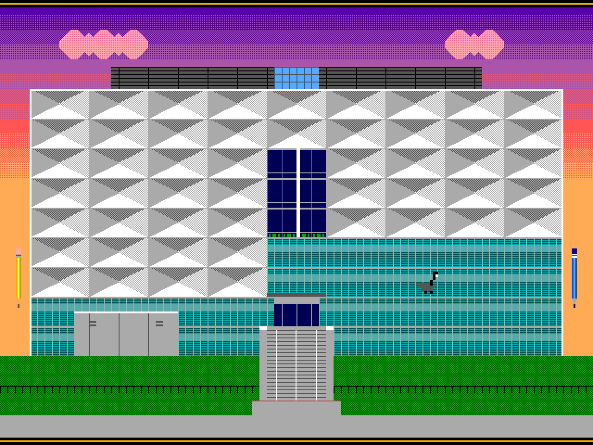
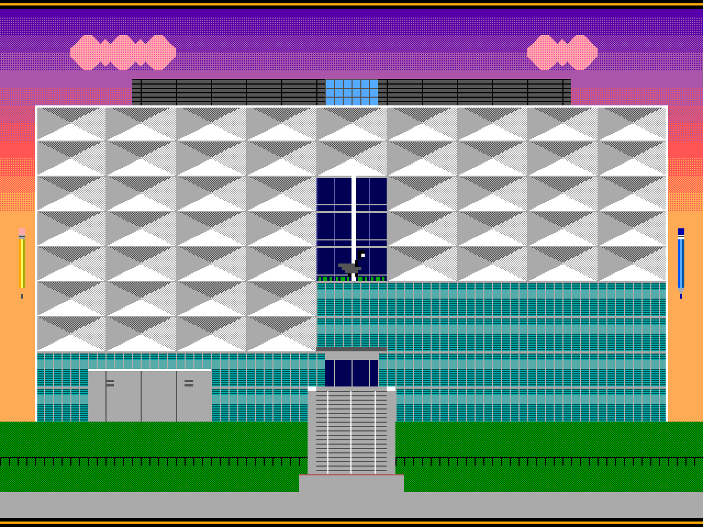
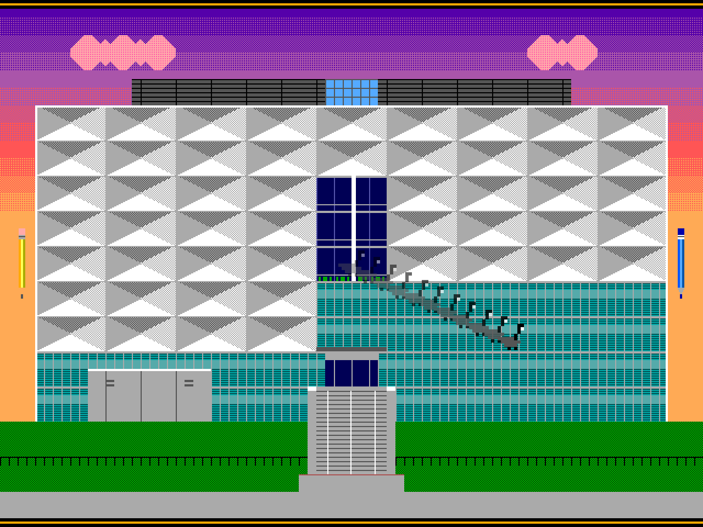
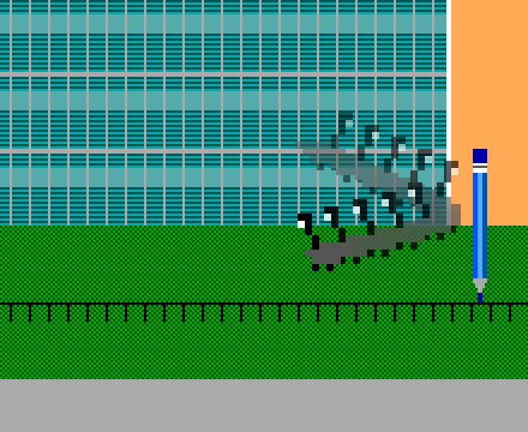
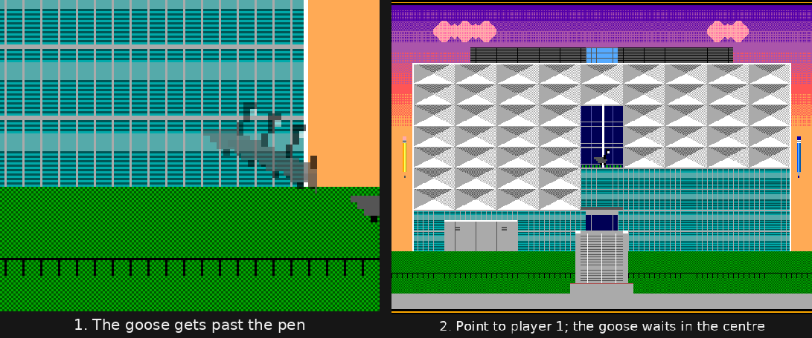
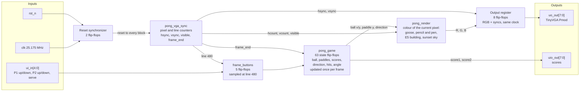
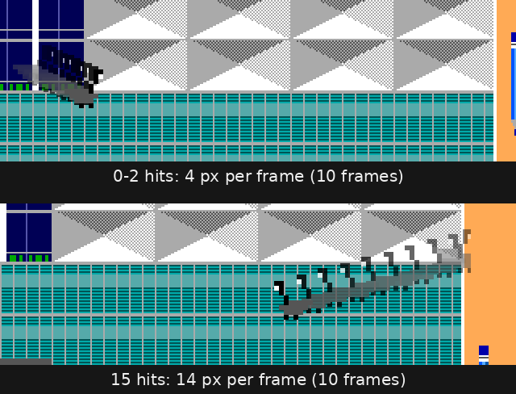
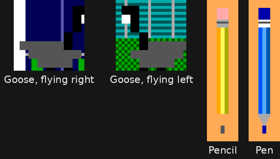
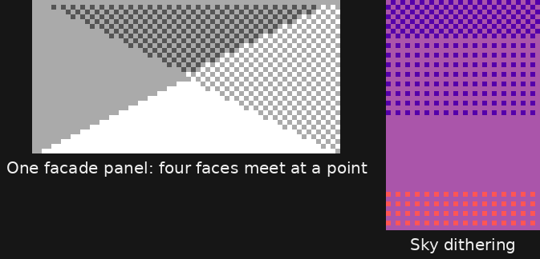

# Pong VGA: Engineering 5 at Sunset

**ECE 298A, University of Waterloo · Tiny Tapeout GF180 (`ttgf26a`) · 1x1 tile**
**Team:** Aaron Sun and Noah Webster · **Top module:** `tt_um_aarons763_pong_vga`

*The chip's actual output, rendered from the Verilog in simulation (shown at 2x).*

This chip plays two-player Pong on any VGA monitor at 640 × 480, 60 frames per
second. The background is the University of Waterloo's Engineering 5 building at
sunset. The ball is a Canada goose, and the paddles are a pencil and a pen.

There is no picture memory on the chip. Every pixel's colour is worked out from
the screen position at the moment the monitor needs it, 25 million times a second.

---

## How we got here

The project went through these stages, roughly in order:

1. **Choosing a project.** We compared a ring-oscillator random number generator
   (TRNG/PUF), a JTAG boundary-scan chain and a VGA game. We chose Pong on VGA
   because it is visual, easy to demo, and exercises timing, logic and verification
   together.
2. **Architecture and split.** Noah took the video timing, the renderer and the VGA
   calculations and tests. Aaron took the game logic, area and timing, and the
   gate-level simulation. We decided on one 25.175 MHz clock, a game update once per
   frame, and no frame buffer.
3. **First working game.** We built the sync generator, the renderer and the
   physics, and played them in VGA Playground. We then refined the motion:
   1/16-pixel ball positions, eight bounce angles from 10° to 45°, equal speeds at
   every angle, and collision checks that can't be skipped by a fast ball.
4. **Making it fit and meet timing.** The first chip builds failed timing at the
   slow manufacturing corner. Aaron made three fixes, described in
   [`docs/timing-fix-1.md`](docs/timing-fix-1.md) to
   [`timing-fix-3.md`](docs/timing-fix-3.md):
   - Read the buttons once per frame, so the physics can take several clocks.
   - Synchronize the reset input.
   - Register all VGA outputs.

   After these, all nine timing corners passed.
5. **Verification.** We added tests at every level: cocotb tests of the video
   timing, buttons, game logic and screen, a plain-Verilog game test, and a C++
   model that checks every pixel. Each is described under [Verification](#verification).
6. **Visual design.** We tried a ball trail with bounce sparks, then three themed
   backgrounds: beach volleyball, the Warriors gym, and Engineering 7. We measured
   the chip area of each and chose a head-on view of **Engineering 5**. A flat
   front view has only horizontal and vertical edges, which are cheap to draw, so
   the space went into building detail.
7. **Gameplay.** We raised the top ball speed from 10 to 14 pixels per frame.
8. **Final build.** The full chip build, Tiny Tapeout's precheck and the
   gate-level tests all pass at **77.9% tile utilisation**.

---

## The chip at a glance

| | |
|---|---|
| Process / size | GlobalFoundries GF180MCU, one Tiny Tapeout tile (about 340 × 160 µm) |
| Clock | 25.175 MHz (the standard VGA pixel clock) |
| Video | VGA 640 × 480 at 59.94 Hz, 64 colours (2 bits each of red, green, blue) |
| Players | 2, with up/down buttons each and a shared serve button |
| Ball | 8 × 8 px for collisions, drawn as a 24 × 24 px Canada goose |
| Paddles | 8 × 64 px, drawn as a yellow pencil (left) and a blue pen (right) |
| Ball speed | 4, 6, 8, 10, 12 then 14 px per frame, rising every 3 paddle hits |
| Bounce angles | 10° to 45° in 5° steps, set by where the ball hits the paddle |
| Scores | 0–15 per player (wraps), on the bidirectional pins |
| Memory | 100 flip-flops; no frame buffer |
| Routed utilisation | **77.889%** of the tile (GitHub `gds` run #25) |

## Pins

| Pin | Direction | Signal |
|---|---|---|
| `ui_in[0]` / `ui_in[1]` | input | Player 1 up / down |
| `ui_in[2]` / `ui_in[3]` | input | Player 2 up / down |
| `ui_in[4]` | input | Serve |
| `ui_in[7:5]` | input | unused |
| `uo_out[0]`, `[4]` | output | Red, high bit / low bit |
| `uo_out[1]`, `[5]` | output | Green, high bit / low bit |
| `uo_out[2]`, `[6]` | output | Blue, high bit / low bit |
| `uo_out[3]` | output | VSYNC (active low) |
| `uo_out[7]` | output | HSYNC (active low) |
| `uio[3:0]` | output | Player 1 score, binary 0–15 |
| `uio[7:4]` | output | Player 2 score, binary 0–15 |
| `clk` | input | 25.175 MHz |
| `rst_n` | input | Reset, active low |

The output pin order matches the TinyVGA Pmod, so a VGA monitor plugs straight
into the Tiny Tapeout demo board. Buttons are read as plain logic levels: high
means pressed.

## How to play

The pictures below come from simulating the chip's Verilog, frame by frame. On
the pictures that show movement, the faded geese are where the goose was in
earlier frames. On the real screen there is only ever one goose.

**1. Start.** Hold `rst_n` low for at least 3 clocks, then release it. The paddles
centre, the scores clear, and the goose waits in the middle of the screen.

**2. Serve.** Press **Serve**. The goose flies toward player 2 (the pen) at 25°,
at the starting speed of 4 px per frame. This picture shows its position every
4 frames after the serve.

**3. Rally.** Each player moves their pencil or pen up and down to hit the goose
back.
- Hitting near the centre of the paddle sends it back flat (10°).
- Hitting near the ends sends it back steep (up to 45°).
- Every third hit in a rally makes it faster, up to 14 px per frame.
- The goose turns around to face the way it's flying.

*Zoomed in on the pen: the goose arrives, bounces off the pen, turns around and
heads back left.*

**4. Point.** When the goose gets past a paddle, the other player scores. The
goose returns to the centre and waits for the next serve, and the speed resets.

---

## Block diagram

Everything runs on one clock. The flip-flops add up to the 100 in the final
build: 63 game state, 20 counters, 8 output, 5 buttons, 2 reset and 2 sync.

---

## How it works

### 1. Reset

`rst_n` passes through two flip-flops before it reaches any logic. This stops a
reset that changes at a random moment from reaching different parts of the chip
on different clock edges. Both the start and the end of reset are synchronous, so
reset must be held for at least 3 clock edges.

### 2. Video timing (`src/pong_vga_sync.v`)

A VGA monitor draws the screen left to right, top to bottom. Two counters track
where the beam is:

| | Visible | Front porch | Sync pulse | Back porch | Total |
|---|---|---|---|---|---|
| Horizontal (pixels) | 640 | 16 | 96 | 48 | **800** |
| Vertical (lines) | 480 | 10 | 2 | 33 | **525** |

The pixel rate is 25.175 MHz, so:
- one line takes 800 clocks: 25.175 MHz ÷ 800 = **31.47 kHz**
- one frame takes 525 lines: 31.47 kHz ÷ 525 = **59.94 Hz**

HSYNC is low for pixels 656–751, and VSYNC is low for lines 490–491. Both come
straight from flip-flops so they never glitch. `visible` says whether the beam is
inside the 640 × 480 picture. `frame_end` pulses for one clock on the very last
pixel of each frame.

### 3. Game logic (`pong_game` in `src/project.v`)

**Once per frame.** The buttons are copied into `frame_buttons` at the start of
line 480, the first line after the picture. On the last clock of the frame,
`frame_end` makes the game take one step. The buttons stay still for the 35,999
clocks in between, so the physics has several clocks to finish. `src/pong.sdc`
tells the layout tools this for exactly those 63 state flip-flops, so the physics
doesn't have to fit in a single 39.7 ns clock.

**Fractional positions.** The ball's position is stored in sixteenths of a pixel.
This is called Q4 fixed point: `ball_x` is 14 bits and `ball_y` 13 bits. The ball
can then move, for example, 3.6 pixels right and 1.7 down each frame, and still
appear on whole pixels. Paddles are stored in whole pixels.

**Velocity table.** One table holds the ball's step per frame for every
combination of 6 speeds and 8 angles: 48 entries, each `(vx, vy)` in sixteenths of
a pixel. Each entry is speed × cos(angle) and speed × sin(angle). The speed is
therefore the same at every angle, to within 0.05 px.

**Each frame:**
1. **Paddles** move 12 px per held button, stop at the walls (y 8–408), and
   don't move if both buttons are held.
2. **Ball** tries its next position.
3. **Walls:** if it would pass the top or bottom wall, it is reflected by the
   amount it overshot, and its up/down direction flips.
4. **Paddles:** if it crossed a paddle's face during this step (checked against
   the face, not just where it lands), and its height overlaps the paddle, it
   bounces.
   - The new angle depends on how far from the paddle's centre it hit, in 4 px
     bands from 10° to 45°.
   - Above centre sends it up, below sends it down.
   - The hit counter goes up by one.
5. **Scoring:** if it passes the far edge, the other player scores. The ball
   parks in the centre, and the hit count and angle reset.
6. **Speed:** the speed tier is hits ÷ 3: 0–2 hits → 4 px, 3–5 → 6, 6–8 → 8,
   9–11 → 10, 12–14 → 12, 15 → 14 px per frame. The 4-bit hit counter stops at 15.

*Ten frames at the slowest speed (top) and at the top speed after 15 hits
(bottom).*

### 4. Renderer (`pong_render` in `src/project.v`)

For every pixel, the renderer decides a colour by checking layers from front to
back and taking the first one that covers that pixel:

1. **Goose (the ball).** An 8 × 8 picture stored in a 128-bit constant (2 bits
   per pixel: black, white, grey, or see-through). Each picture pixel is drawn as
   3 × 3 screen pixels, so the goose is 24 × 24, centred on the 8 × 8 ball. It's
   mirrored when the ball moves left, so it always faces where it's flying.
2. **Pencil and pen (the paddles).** Drawn row by row inside the 8 × 64 paddle
   box. The pencil has a pink eraser, metal band, three-shade yellow body, wood
   cone and graphite point. The pen has a cap, white band, blue body and tip.

   
3. **End walls.** Black with a UW gold stripe.
4. **Ground.** Sidewalk, stairs (step lines, three handrails, concrete side walls,
   a landing), the walkway, a black fence and grass.
5. **Building:**
   - the rooftop mechanical level, with louvres and a glass centre
   - white corner edges and top line
   - the two-storey atrium, with its white column, floor slabs, balcony rail and
     plants
   - the entrance doors and canopy on the second floor
   - the concrete wall, with its cap and vents
   - the glass storeys, with frames between the panes, floor lines and sky
     reflections
   - eight floors of **folded panels**. Each 64 × 32 panel is split into four
     faces that meet at its centre: top darkest, left mid grey, right light grey,
     bottom white. This is the folded look of the real building's facade.
6. **Clouds.** Scalloped shapes built from round puffs, lit pink.
7. **Sunset sky.** Dusky purple at the top, through pink and salmon, to orange.

**Making the drawing small.** Seen straight on, every edge is horizontal or
vertical and sits on an 8, 16 or 32 pixel grid. Most checks are therefore short
comparisons of the counters' upper bits, with no maths per pixel. The goose is
positioned using the offset from the ball, which the renderer already has.

**Extra shades.** With 2 bits per colour, there are only 64 colours. Where a
shade in between is needed, such as the smooth sky or two of the panel greys, the
renderer alternates two neighbouring colours in a fine checkerboard of pixels.
This is called ordered dithering, and from a normal distance the eye blends them.

*Left: one facade panel, enlarged 6x. The two checkerboard faces are dithered
greys. Right: the sky, where each band blends into the next with dithering.*

### 5. Output stage

The 6 colour bits and both syncs are stored in one 8-bit register on the same
clock edge. The picture and its sync timing therefore always arrive together, one
clock after the counters.

---

## Physical design results

Results from GitHub Actions, `gds` workflow run #25 (commit `f345ef6`):

| Check | Result |
|---|---|
| Chip build (LibreLane, `ttgf26a`) | ✅ passed. 77.889% utilisation, 1,856 cells, 100 flip-flops, 75,095 µm of wire |
| Tiny Tapeout precheck (12 checks, including GF180 DRC, antenna, pins, power) | ✅ all passed |
| Gate-level test (the cocotb tests run on the real gates) | ✅ passed |
| `test`, `docs` and `transistors` workflows | ✅ passed |
| `viewer` (publishes the 3D layout viewer page) | ✅ passed |

**Timing.** The clock is constrained to 39.7 ns. The game physics has a 4-cycle
limit, written in `src/pong.sdc`, because its inputs only change once per frame.
After Aaron's three timing fixes, before the picture was redrawn, all nine corners
passed: worst setup slack (spare time before the clock edge) was +1.07 ns at the
slow corner, with no hold problems. The renderer was redrawn after that. Its
worst path is about 18 ns in our own estimate at the slow corner, against the
39.7 ns budget. The slow-corner slack for this revision should still be read
from the `GDS_logs` artifact of the latest run.

---

## Verification

### Tests

The cocotb tests (`test/`) run on GitHub on every push, first on the Verilog and
then again on the real gates after the chip build. The directed game tests and the
pixel checker (`sim/`) are run with Icarus Verilog and Verilator.

| Test | Where | What it checks | Result |
|---|---|---|---|
| `test_line_timing` | `test/test_vga_sync.py` | Every pixel of the two gold-stripe lines: 640 visible, then 16 / 96 / 48, HSYNC low for exactly 656–751, VSYNC high | ✅ |
| `test_frame_timing` | same | Picture ends after line 479, VSYNC low for exactly lines 490–491, next frame exactly 420,000 clocks later | ✅ |
| `test_reset_mid_frame` | same | Reset in mid-frame restarts the picture at line 0 with syncs on time | ✅ |
| `test_recovers_from_impossible_count` | same | Counters forced to impossible values recover within a frame without reset (skipped at gate level) | ✅ |
| `test_vga_numbers` | same | The VESA arithmetic behind the tests | ✅ |
| `test_frame_button_capture` | `test/test_frame_buttons.py` | Buttons are captured at line 480 only, the game changes only at frame end, reset clears within 3 clocks | ✅ |
| `test_paddles_move_on_screen` | `test/test_screen.py` | On the real pins, holding buttons moves the pencil and pen by exactly 12 px in one frame | ✅ |
| Directed game tests | `sim/tb_features.v` | All 192 speed × angle × direction steps against its own sin/cos, sub-pixel travel, 142 paddle contact points on both sides, the hit and speed limits, swept collisions, wall reflection, scoring and serve | ✅ |
| Pixel reference | `sim/tb.cpp` + `sim/run.sh` (Verilator) | Runs the whole chip and compares **every pixel, sync and score** with a C++ model. The model is written separately from the Verilog and covers the game physics (using its own sin/cos) and the full E5 picture. Rally (1,600 frames) and random-button (800 frames) runs. | ✅ 0 mismatches |
| Gate-level | `gds` → `gl_test` | The cocotb tests on the real gate-level netlist | ✅ |

### VGA Playground

To play in the browser:
1. Open <https://vga-playground.com/?preset=gamepad>.
2. In its `project.v` tab, paste [`playground/keyboard_top.v`](playground/keyboard_top.v),
   then `src/project.v`, then `src/pong_vga_sync.v`.
3. Turn on Gamepad mode.

**Controls:**
- Player 1: Up / Down arrows
- Player 2: Y / B
- Serve: A
- Reset: Shift+R

The wrapper only exists for the Playground and isn't part of the chip. The
Playground's FPS counter measures how fast your browser can simulate the chip,
not the chip's own frame rate, which is always 59.94 Hz.

---

## Repository layout

| Path | Contents |
|---|---|
| `src/project.v` | Top level, reset synchronizer, button capture, `pong_game`, `pong_render`, output register |
| `src/pong_vga_sync.v` | VGA counters and syncs |
| `src/pong.sdc`, `src/config.json` | Timing constraints (39.7 ns clock, 4-cycle physics) and build settings |
| `test/` | cocotb tests and testbenches (`tb.v` for the whole chip, `tb_game.v` for the game) |
| `sim/` | Verilog directed tests and the Verilator pixel checker |
| `playground/` | Keyboard wrapper for VGA Playground |
| `docs/info.md` | Tiny Tapeout datasheet page |
| `docs/timing-fix-*.md` | The three timing fixes |
| `info.yaml` | Tiny Tapeout project settings and pin names |

